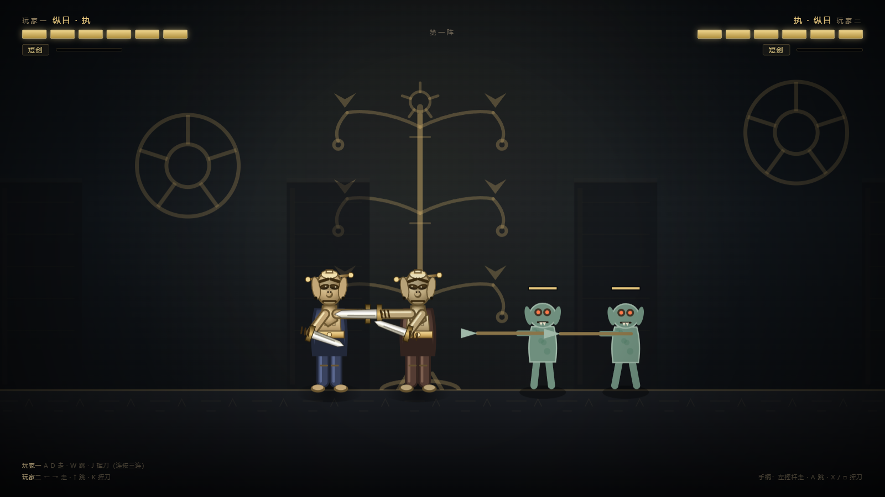

# 双刃战士 · 纵目

> 三星堆青铜人头像主题的**双人同屏横版清版动作游戏**。
> 单页应用，零依赖，断网可运行，支持两把游戏手柄。

东莞市博物馆 × 碳基社区「AI 创作者进馆计划」参赛作品（AI 编程赛道）。

---

## 这是什么

4399《双刃战士》（Nitrome, 2011）那一类玩法：两个人挤在一台电脑前，各握双刃，一路砍过去，捡武器、打连击、放旋风斩。

主角换成了 **三星堆八号祭祀坑出土的青铜人头像**——这张脸被从土里挖出来，现在站起来，手里握着两把刀。

---

## 怎么玩

双击 `index.html`，用浏览器打开。
按任意键进入**单双人模式选择**：按 `1` 单人独守，按 `2` 双人同屏。
不需要联网，不需要安装任何东西，不需要本地服务器。

### 键盘

| 动作 | 玩家一 | 玩家二 |
|---|---|---|
| 左右移动 | `A` / `D` | `←` / `→` |
| 跳跃 | `W` 或 `空格` | `↑` 或 `右 Shift` |
| 攻击 / 拾取 | `F` 或 `J` | `/` 或 `小键盘 0` 或 `K` |
| 旋风斩 | 能量满时 跳 + 攻击 同按 | 能量满时 跳 + 攻击 同按 |
| 按键说明 | `H` 或 `Esc` | `H` 或 `Esc` |

### 手柄

两把手柄可各控一人，插上按任意键即被识别。
左摇杆或十字键移动，`A` 跳，`X`（Xbox）/ `□`（PS）挥刀；`B`（Xbox）/ `○`（PS）同样触发挥刀。
只插一把手柄也能玩，两人共用移动方向。

---

## 机制

- **三连击**：连按攻击键出三段，第三段伤害更高、范围更大、击退更远。
- **武器掉落**：普通敌人击杀有 34% 概率掉 1 把；BOSS 必掉 3 把（1 把随机 + 固定青铜剑与神树锤）。走过去按攻击键拾取，旧武器掉回地上。
  - 掉落池四种：骨牙匕（最快，耐久 16）｜青铜剑（伤害 2）｜神树锤（伤害 4、范围最大、最慢）｜眼形石（伤害 3、可投 3 次）。
- **武器耐久**：每种武器挥够次数会碎，碎后变成**空手**，伤害只有 0.5，必须去捡。
- **同款不叠**：手上已是同一种武器时不捡地上的那把，屏幕飘字「同款武器，先扔掉」。
- **空手**：无限耐久，伤害极低，是保底状态不是初始状态（初始是玉璋刃，耐久 40）。
- **远程**：两套机制都已实现——弓走直线箭（速度 1180），投掷走抛物线石块（受重力 1500）。
- **旋风斩**：命中攒能量（每次 +7），满 100 时 跳 + 攻击 同按，1.5 秒内每 0.13 秒判定一次，半径 200。
- **打队友**：挥刀能命中同伴，**不掉血**；对方手里不是玉璋刃时被震飞，换回玉璋刃——原作那个坑队友的设计。
- **Boss**：器心 · 纵目之主，26 血，出手后有硬直，硬直中受伤翻倍并飘「弱点 ×2」。

四波敌人：第一阵 3 只 / 第二阵 5 只 / 第三阵 5 只 / 器心 · 纵目之主 1 只。
敌人四种：`walker` 铜锈俑、`fast` 疾行俑、`brute` 厚甲俑、`boss` 纵目之主。

---

## 素材从哪来

- 角色、敌人、背景、道具、刀光，全部由 **AI 生图 + 手工后处理** 得到，不是纯代码绘制。
- 生图统一用洋红底，后处理按 `min(R,B)-G` 量化抠图并做 despill，否则边缘会留一圈紫。
- 逐帧素材按动作条带切分，再统一锚点与画布尺寸，最后压成 WebP。
- 素材共 73 个文件、约 2.5 MB，全部随仓库离线分发，运行期零网络请求。
- 流程与脚本见 [tools/README.md](tools/README.md)，设计约束见 [docs/ARCHITECTURE.md](docs/ARCHITECTURE.md)。

---

## 角色是照着馆方原文画的

每一个五官都不是随手编的：

> 圆顶笄发，头顶浑圆，头发与面部界限分明。长脸宽颐，脸庞瘦削，宽眉大眼，眼角上挑，
> 蒜头鼻，鼻翼较宽，阔口紧闭，神情肃穆。大耳外张，耳垂各有一穿孔，可能用于悬挂耳环
> 之类的装饰品。颈较粗，颈下端前呈倒尖角形，后呈圆弧形。头顶后方有一方孔，其下有"U"形轮廓。

出处：**《吉金万里 重点文物说明（20260929）》**，东莞市博物馆提供。

对应到代码里：

| 原文 | 实现 |
|---|---|
| 圆顶笄发 | 头顶浑圆，横插一根笄，两端露出圆头 |
| 长脸宽颐 | 竖向椭圆脸，非圆脸 |
| 宽眉大眼，眼角上挑 | 粗眉紧压眼上，杏仁眼、外眼角上扬 |
| 蒜头鼻，鼻翼较宽 | 球状鼻头 + 双鼻孔 |
| 阔口紧闭 | 一条厚横线，加下唇高光 |
| 大耳外张，耳垂穿孔 | 两侧外展耳廓，耳垂各一个小黑孔 |
| 颈较粗，下端前呈倒尖角形 | 梯形颈，前端收成倒三角 |
| 头顶后方方孔、"U"形轮廓 | 头顶后方的方形刻线 |

**艺术处理部分**：双刃武器、锈蚀怪物、波次数值、旋风斩、武器耐久，以及青铜神树与太阳轮的场景化呈现，都是为游戏性服务的再创作，**不是考古复原**。

---

## 技术

- 单页应用：一个 `index.html` + 七个脚本模块 + 素材目录，`file://` 直接打开即可运行。
- 零依赖：无 CDN、无 npm、无外部字体；脚本全部 IIFE 挂 `window.*`，不用 ES module（`file://` 下会被 CORS 拦）。
- Canvas 2D 逐帧绘制，角色显示高度 252px，9 个动作共 32 帧；敌人 4 类共 14 帧。
- 四层视差：远景 0.20 / 中景 0.50 / 地面 1.00 / 前景 1.30。
- 三级降级：素材缺失时逐级回退（帧图 → 单图变换 → 纯代码矢量绘制），任何情况下不白屏。
- 音效由 Web Audio API 实时合成，无版权素材。
- 手柄走 Gamepad API 轮询，支持双人双柄。
- 1600×900 逻辑分辨率，按窗口等比缩放；世界宽 3400，地面线 706。

---

## 已知边界

这是**参赛 demo**，不是商业成品：

- 4 波敌人 + 1 个 BOSS，玩熟约三分钟通关。
- 没有坐骑（原作有野猪、老虎）。
- 远程攻击已实现，但神鸟弓不在掉落池里，实机拿不到；青铜钺、三枝叉同样只在武器表里，无发放路径。
- 无存档、无联机、无关卡选择。

---

## 文件

| 路径 | 说明 |
|---|---|
| `index.html` | 游戏本体：DOM、样式、主循环与全部判定逻辑 |
| `js/` | 七个脚本模块（资源、动画数据、背景、角色、敌人、特效、UI），索引见 [js/README.md](js/README.md) |
| `assets/` | 背景、地面、道具、刀光、角色与敌人的逐帧 WebP |
| `tools/` | 生图后处理与切片脚本、自检脚本，见 [tools/README.md](tools/README.md) |
| `docs/` | 架构说明与截图 |
| [双刃战士玩法介绍.md](双刃战士玩法介绍.md) | 原作机制对照笔记 |
| [文案包.md](文案包.md) | 参赛作品介绍、三平台发布文案、讲解稿 |
| [操作与录屏说明.md](操作与录屏说明.md) | 按键表、录屏分镜、现场话术 |
| [交付清单.md](交付清单.md) | 提交前核对 |

维护者请看 [AGENTS.md](AGENTS.md)（规则与仪表盘）与 [docs/ARCHITECTURE.md](docs/ARCHITECTURE.md)（设计决策）。

---

## 许可

代码以 MIT 许可开源。

文物描述文字出自东莞市博物馆提供的馆方资料，版权归原机构所有，此处仅作文化依据引用。
