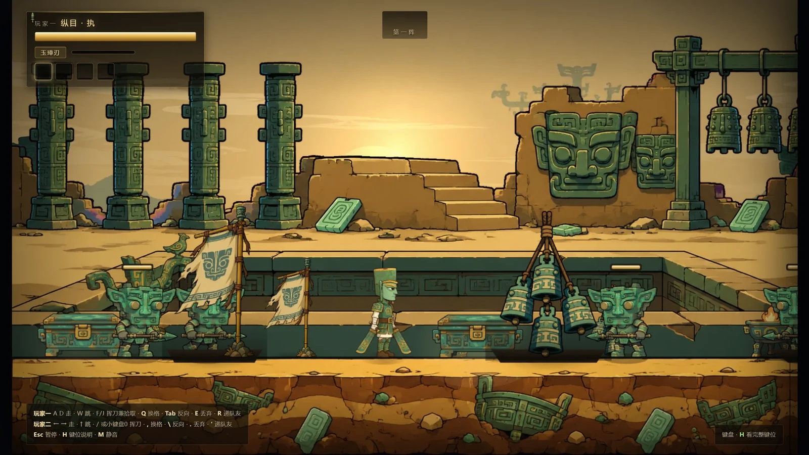

# 双刃战士 · 纵目

> 两个纵目祭司，守着一座祭祀坑，把从坑里爬出来的锈蚀打回去。

横版、双人同屏、一人一把刀。双击 `index.html` 就开打 —— 不用装东西、不用联网、不用起服务。

东莞市博物馆 × 碳基社区「AI 创作者进馆计划」参赛作品（AI 编程赛道）。

## 怎么开始

1. 双击 `index.html`（Chrome / Edge / Firefox 都行）。
2. 按任意键，选 **1 单人** 或 **2 双人同屏**。
3. 打六阵，最后一关是器心 · 纵目之主。

手机上打开 `mobile.html`，或者访问部署后的 `https://你的域名/mobile.html`；
也可以「添加到主屏幕」，从图标进去就是全屏横屏版。

## 怎么玩

- **一人一把刀，刀会碎。** 武器从敌人身上掉，近战各有耐久，挥到 0 就断；断了先空手，得走过去再捡一把。
- **连按攻击出三连击**，第三段最重。
- **命中攒能量，满了放旋风斩**：1.5 秒无敌，六把刀环身。
- **两个人能互相打到。** 不掉血，但会把队友的刀震飞出去 —— 原作那个坑队友的设计，我们留着。

最小键位（完整表见 [docs/OPERATIONS.md](docs/OPERATIONS.md)）：

| | 玩家一 | 玩家二 |
|---|---|---|
| 走 / 跳 | `A` `D` / `W` | `←` `→` / `↑` |
| 挥刀 / 旋风斩 / 拾取 | `J` / `K` / `L` | 小键盘 `4` / `5` / `6` |

手柄插上按任意键即被识别，两把可各控一人（`A` 挥刀 / `X` 跳 / `B` 技能 / `Y` 拾取）。
界面上的键位说明会自动切成你正在用的那套设备，键盘图和手柄图不会同时出现。

## 有什么

- **六阵逐阵加量**，杂兵一档比一档厚，末阵是器心 · 纵目之主。
- **十一种武器**：七件近战 + 四件投掷。弓走直线箭，投掷物走抛物线，各有自己的手感。
- **宝箱与机关**：破阵开箱拿武器或消耗品，阵末机关能回血或催下一阵提前来。
- **四层视差背景**，走到高物背后会自动淡下去，看得见轮廓。
- **打击音按武器材质分流**（玉 / 骨 / 青铜 / 锤 / 陶 / 铃），BGM 跟着阵次升档。
- **手机、桌面、手柄三套操作**同一份代码，一个动作一个键。

## 这张脸是照着馆方原文画的

不是凭印象捏的一张脸。主体是三星堆八号祭祀坑出土的青铜人头像（馆方称其为祭司形象），
五官逐条对着馆方资料来：

> 圆顶笄发，头顶浑圆，头发与面部界限分明。长脸宽颐，脸庞瘦削，宽眉大眼，眼角上挑，
> 蒜头鼻，鼻翼较宽，阔口紧闭，神情肃穆。大耳外张，耳垂各有一穿孔。颈较粗，
> 颈下端前呈倒尖角形，后呈圆弧形。头顶后方有一方孔，其下有"U"形轮廓。

出处：《吉金万里 重点文物说明（20260929）》，东莞市博物馆提供。

八条描述一一对应到代码里的八个参数，对照表与青铜病的准确表述都在
[docs/GAMEPLAY.md](docs/GAMEPLAY.md)。

锈也不是背景色。敌人来自**青铜病**（俗称青铜癌）：氯离子在铜里自催化的活性腐蚀，
产物是浅绿粉末状的氯铜矿，会蔓延、不可逆 —— 而器物上一层层的致密绿锈反而是保护层。
游戏把这场病害拟人化成从坑壁爬上来的敌人。

双刃、锈蚀怪物、波次数值、旋风斩、武器耐久、投掷物、宝箱机关，都是为游戏性加的再创作，
**不是考古复原**。

## 这是参赛 demo，不是成品

没有坐骑（原作有野猪、老虎），没有存档、联机、关卡选择。六阵打完就通关。

## 想再往下看

| 想知道 | 去哪 |
|---|---|
| 键位、各页面怎么操作 | [docs/OPERATIONS.md](docs/OPERATIONS.md) |
| 玩法细节、武器数值、六阵与文物对照 | [docs/GAMEPLAY.md](docs/GAMEPLAY.md) |
| 为什么这么设计、有哪些硬约束 | [docs/ARCHITECTURE.md](docs/ARCHITECTURE.md) |
| 素材怎么生、怎么切、怎么验 | [tools/README.md](tools/README.md) |
| 部署到服务器、手机上怎么用 | [docs/DEPLOY.md](docs/DEPLOY.md) · [docs/MOBILE.md](docs/MOBILE.md) |
| 参赛文案、录屏脚本 | [文案包.md](文案包.md) · [操作与录屏说明.md](操作与录屏说明.md) |
| 动手改代码 | [AGENTS.md](AGENTS.md)（规则与仪表盘）；改一处要同步哪几处 → [docs/README.md](docs/README.md) |
## 许可

代码以 MIT 许可开源。

文物描述文字出自东莞市博物馆提供的馆方资料，版权归原机构所有，此处仅作文化依据引用。
