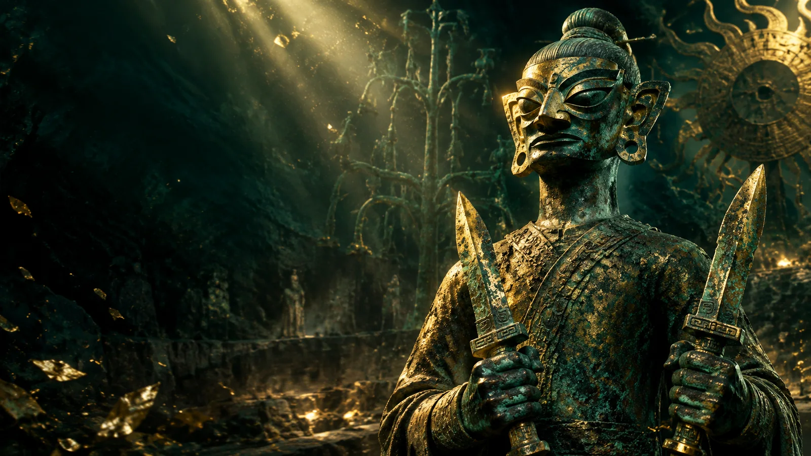
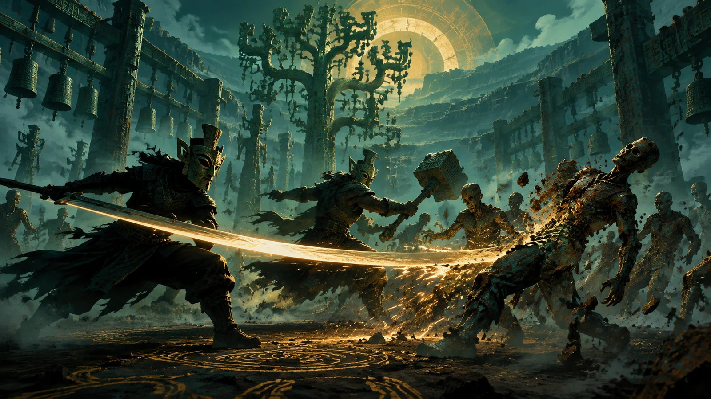
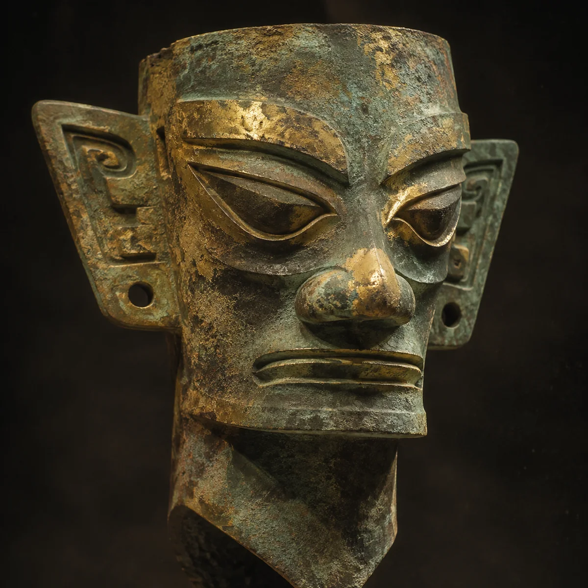

# 双刃战士 · 纵目

> 三星堆青铜人头像主题的**双人同屏横版清版动作游戏**。
> 单页应用，零依赖，断网可运行，支持两把游戏手柄。

东莞市博物馆 × 碳基社区「AI 创作者进馆计划」参赛作品（AI 编程赛道）。

---

## 这是什么

4399《双刃战士》（Nitrome, 2011）那一类玩法：两个人挤在一台电脑前，各握双刃，
一路砍过去，捡武器、打连击、放旋风斩。

主角换成了**三星堆八号祭祀坑出土的青铜人头像**——
这张脸被从土里挖出来，现在站起来，手里握着两把刀。

---

## 怎么玩

双击 `index.html`，用浏览器打开。

1. 按任意键进入**单双人模式选择**。
2. 按 `1` 单人独守，按 `2` 双人同屏。
3. 开局先播一段 10.5 秒以内的开场短片，按住任意动作键可跳过。

不需要联网，不需要安装任何东西，不需要本地服务器。

### 键盘

| 动作 | 玩家一 | 玩家二 |
|---|---|---|
| 左右移动 | `A` / `D` | `←` / `→` |
| 跳跃 | `W` 或 `空格` | `↑` 或 `右 Shift` |
| 挥刀 · 连按三连 | `F` 或 `J` | `/` 或 `小键盘 0` 或 `K` |
| 拾取 / 开箱 | `G` | `;` |
| 丢弃手上武器 | `E` | `.` |
| 递给队友 | `R` | `'` |
| 旋风斩 | 能量满时 跳 + 攻击 同按 | 同左 |
| 暂停 | `Esc` | `Esc` |
| 按键说明 | `H` | `H` |
| 静音 | `M` | `M` |

> 挥刀与拾取是两个键：刀只管打，捡东西按 `G` / `;`。
> 武器只有手上那一把，捡到好的直接换手，旧的落回原地。

### 手柄

两把手柄可各控一人，插上按任意键即被识别。
识别到手柄后，界面上的键位会整体换成手柄版 —— 键盘与手柄两套永不同时出现。

| 操作 | 按键 |
|---|---|
| 左右移动 | 左摇杆 / 十字键左右 |
| 挥刀 · 连按三连 | `A`（Xbox）/ `×`（PS） |
| 跳 | `X`（Xbox）/ `□`（PS） |
| 旋风斩（能量满） | `B`（Xbox）/ `○`（PS） |
| 拾取 / 开箱 | `Y`（Xbox）/ `△`（PS） |
| 递给队友 / 丢弃 | 十字上 / 十字下 |
| 暂停 / 继续 | `Start` 或 `Back`（暂停页 `A` / `B` 也算继续） |

模式选择页的键位是**直选**，不是「移动光标 + 确认」：

- `A` / `X` 直接进单人，`B` / `Y` 直接进双人。
- `Start` 确认当前高亮项。

只插一把手柄时：手柄控玩家一（走位 + 挥刀 / 跳 / 技能 / 拾取 / 丢弃 / 递队友），
玩家二用键盘（`←/→` 走、`↑` 跳、`/` 或小键盘 `0` 挥刀、`;` 拾取、`.` 丢弃、`'` 递队友）。

手柄震动走 Gamepad 的 `vibrationActuator`：
挥刀、命中、受击、阵亡、开箱、机关、破阵各有预设波形。
不支持 dual-rumble 的浏览器（Firefox / Safari）整条链路静默无动作。

### 手机

手机端是**同一个游戏**，不是另一个版本 —— 代码、素材、玩法完全一致，
只多了屏幕上的虚拟按键（每人 8 枚动作键 + 暂停 / 说明 2 枚系统键，青铜盘打底；
持械时攻击键键面换成手上那把武器的图标）。

| 入口 | 用途 |
|---|---|
| `index.html` | 桌面版。电脑上打开就是这个（键盘 / 手柄界面） |
| `mobile.html` | **手机版入口**。手机浏览器打开它，或部署后访问 `https://你的域名/mobile.html` |

手机上用 `mobile.html` 的理由：它会带 `?touch=1` 强制进入触屏档，
不用等第一次手指落下才切换（从主屏图标启动时没有手指事件，虚拟键会不出现）。

**自动判断**：在手机上直接打开 `index.html` 也会自动进触屏档。
判据是触摸硬件，不是 `PointerEvent` ——
在触摸屏笔记本上用鼠标玩仍保持桌面界面。

逻辑视口在触屏档按屏幕宽高比加宽（上限 2100，高度恒 900），
所以横屏手机能填满屏幕，而角色尺寸与所有判定盒一个像素都不变。

URL 参数可强制：

| 参数 | 效果 |
|---|---|
| `?touch=1` | 强制触屏版（虚拟键 + 触屏图例 + 竖屏提示） |
| `?touch=0` | 强制桌面版（触摸屏笔记本上想用鼠标玩时用） |

---

## 机制

- **单双人模式**：进场先选。单人时玩家二不存在，HUD 上那一条整块收起。
- **连续血条**：气血是一根渐变的条，不是一格一格的方块；掉到四分之一以下转红并闪烁。
- **三连击**：连按攻击键出三段，第三段伤害 +1、够到距离 ×1.15、击退更远。
- **动作按武器分流**：斧与锤走劈砍（`attack-heavy`），叉、匕、玉璋刃走突刺（`attack-thrust`），
  剑、弓与空手走基础挥砍 —— 三种动作各有一套帧图。
- **单手一把**：手上只拿一把，没有备用格。
  - 空手捡起直接上手；手上有别的就换手，换下来的那把落回原地。
  - `E` 丢掉手上那把，回到空手。
  - `R` 交给队友，两人相距 160 像素内才递得过去；队友手上有武器时两人对换。
- **同款不叠**：手上已有同一种武器，地上的那把就不捡，飘字「同款武器，先扔掉」。
- **武器耐久**：每种武器挥够次数会碎，碎后回到**空手**（伤害 1），必须去捡。
- **掉落池 11 种**，按阵次进退场：

  | 出现阵次 | 武器 |
  |---|---|
  | 第一阵起 | 青铜剑｜眼形石（唯一的高伤远程） |
  | 只在第一、二阵 | 玉璋刃（初始，耐久 55）｜骨牙匕（最快，耐久 26、全场总输出最低） |
  | 第二阵起 | 青铜钺｜三枝叉（最长）｜玉璋镖 |
  | 第三阵起 | 神树锤（伤害最高、范围最大、最慢）｜陶罐雷｜青铜铃｜神鸟弓 |

  - 池内均匀随机，没有加权表。
  - 普通敌人击杀有 35% 概率掉武器。
  - 宝箱从当前池抽，非基础档权重加倍。
  - BOSS 必掉 3 把：青铜剑、神鸟弓、神树锤。
  - **低伤害武器会退场**：玉璋刃与骨牙匕第三阵起不再掉落。
    判据是敌人构成 —— 铜锈俑 5 血时 2 伤武器仍是主力升级，
    而厚甲俑 12 血要砍 6 刀、末阵 BOSS 60 血要砍 30 刀。
    单手一把语义下捡错一把等于当场变弱，所以后期不再让它们占手。
- **四种投掷物**：眼形石稳准、玉璋镖快而穿（穿 2 个）、陶罐雷慢炸大（引信 0.45 秒、半径 130）、
  青铜铃弹地一次再爆。
  - 投掷物带**弹数**而不是耐久：初始 3 发、上限 5 发。
  - 扔完脱手，落点留一枚残骸；走回去按拾取键能捡回一发。
- **两条远程路线**：弓走直线箭（速度 1180、无重力），投掷物走抛物线（重力按各自参数，200~1600 不等）。
- **宝箱**：破阵奖励，两座。走近按拾取键开启，一箱 1 件：
  武器 32% / 海贝 40% / 玉器 28%。
- **机关**：前五阵各浮出一座青铜机关，一种是回满两人气血，一种是让下一阵提前到来。
- **消耗品**：海贝回气血 2 点，玉器回能量 50 点。
- **旋风斩**：命中攒能量（每次 +7），满 100 时 跳 + 攻击 同按。
  1.5 秒内每 0.13 秒判定一次，半径 200，期间无敌。
- **打队友**：挥刀能命中同伴，**不掉血**；对方手里不是玉璋刃时被震飞、武器脱手，
  换回玉璋刃 —— 原作那个坑队友的设计。
- **Boss**：器心 · 纵目之主，60 血，出手后有硬直，硬直中受伤翻倍并飘「弱点 ×2」。

### 六阵与剧情

每阵开场打一条 2.5 秒的叙事条，三行一段，用器物的口吻串成一条线：
从被挖出来，到认出锈蚀的源头是自己剥下的那层壳。

| 阵 | 副题 | 体数 | 机关 |
|---|---|---|---|
| 第一阵 | 锈蚀试探 | 8 | 回血 |
| 第二阵 | 它们跑起来了 | 12 | 加速 |
| 第三阵 | 厚甲压上来 | 15 | 回血 |
| 第四阵 | 坑壁塌了 | 18 | 加速 |
| 第五阵 | 它们数着我的名字 | 21 | 回血 |
| 器心 · 纵目之主 | 锈蚀的源头 | 11 | — |

共 85 体。敌人四种：`walker` 铜锈俑、`fast` 疾行俑、`brute` 厚甲俑、`boss` 纵目之主。

---

## 素材从哪来

- 角色、敌人、背景、道具、刀光、图标，全部由 **AI 生图 + 手工后处理** 得到，不是纯代码绘制。
- 生图统一用洋红底，后处理按 `min(R,B)-G` 量化抠图并做 despill，否则边缘会留一圈紫。
- 逐帧素材按动作条带切分，再统一锚点与画布尺寸，最后压成 WebP。
- 拾取图标切完再统一到同一张正方形画布、按最长边占固定比例居中，所以地上那堆武器不会忽大忽小。
- 素材共 281 个文件、20.11 MB，全部随仓库离线分发，运行期零网络请求。
  其中音频 6.78 MB、视频 4.53 MB，纯游戏图形素材为 278 个文件 8.31 MB。
- 另有 `showcase.html` 素材总览页：7 个 tab 陈列全部 199 帧动画与静态图，
  `node serve-showcase.mjs` 起本地服务即可看，双脚本入口见 `启动展示页.bat`。
- 流程与脚本见 [tools/README.md](tools/README.md)，设计约束见 [docs/ARCHITECTURE.md](docs/ARCHITECTURE.md)。

---

## 角色是照着馆方原文画的

每一个五官都不是随手编的：

> 圆顶笄发，头顶浑圆，头发与面部界限分明。长脸宽颐，脸庞瘦削，宽眉大眼，眼角上挑，
> 蒜头鼻，鼻翼较宽，阔口紧闭，神情肃穆。大耳外张，耳垂各有一穿孔，可能用于悬挂耳环
> 之类的装饰品。颈较粗，颈下端前呈倒尖角形，后呈圆弧形。头顶后方有一方孔，其下有"U"形轮廓。

出处：**《吉金万里 重点文物说明（20260929）》**，东莞市博物馆提供。

对应到代码里：

| 原文 | 实现 |
|---|---|
| 圆顶笄发 | 头顶浑圆，横插一根笄，两端露出圆头 |
| 长脸宽颐 | 竖向椭圆脸，非圆脸 |
| 宽眉大眼，眼角上挑 | 粗眉紧压眼上，杏仁眼、外眼角上扬 |
| 蒜头鼻，鼻翼较宽 | 球状鼻头 + 双鼻孔 |
| 阔口紧闭 | 一条厚横线，加下唇高光 |
| 大耳外张，耳垂穿孔 | 两侧外展耳廓，耳垂各一个小黑孔 |
| 颈较粗，下端前呈倒尖角形 | 梯形颈，前端收成倒三角 |
| 头顶后方方孔、"U"形轮廓 | 头顶后方的方形刻线 |

**艺术处理部分**：双刃武器、锈蚀怪物、波次数值、旋风斩、武器耐久、投掷物、宝箱与机关，
以及青铜神树与太阳轮的场景化呈现，都是为游戏性服务的再创作，**不是考古复原**。

---

## 技术

- 单页应用：一个 `index.html` + 十二个脚本模块 + 素材目录，`file://` 直接打开即可运行。
- 零依赖：无 CDN、无 npm、无外部字体；脚本全部 IIFE 挂 `window.*`，不用 ES module
  （`file://` 下会被 CORS 拦）。
- Canvas 2D 逐帧绘制，角色显示高度 252px，12 个动作共 43 帧；敌人 4 类共 14 帧。
- 三层视差：远景 0.20 / 中景 0.50 / 地面 1.00，另加 11 座散在世界坐标上的静物道具。
  角色之后没有前景遮挡层 —— 遮挡会把角色盖住，整套已删除。
- 三级降级：素材缺失时逐级回退（帧图 → 单图变换 → 纯代码矢量绘制），任何情况下不白屏。
- 音效实时合成，零音频文件、无版权素材。打击音按武器材质分流（玉 / 骨 / 青铜 / 锤 / 陶 / 铃），
  低频尾长跟随顿帧；背景音乐是 `assets/audio/bgm-main.mp3`，
  分 drone、节奏、氛围三层，随六阵升档，血量见底时低通下压、BOSS 硬直时自动让位。
  音轨缺席或被拦时自动退回程序化 BGM（分档动机仍是实时合成）。`M` 键静音。
- 开场短片 `assets/video/short_land.mp4`，10.5 秒上限；模块缺席或视频加载失败立刻开局。
- 手柄走 Gamepad API 轮询，支持双人双柄 + 震动；键位图例随「谁在动」切换。
- 1600×900 逻辑分辨率，按窗口等比缩放；触屏档按屏幕比例加宽（上限 2100）。
  世界宽 3400，地面线 706。

---

## 已知边界

这是**参赛 demo**，不是商业成品：

- 六阵，逐阵加量，末阵是器心 · 纵目之主带十名随从。
- 没有坐骑（原作有野猪、老虎）。
- 无存档、无联机、无关卡选择。
- 触屏按键只有横屏布局；竖屏只给「请横过来玩」的提示遮罩。

---

## 文件

| 路径 | 说明 |
|---|---|
| `index.html` | 游戏本体：DOM、样式、主循环与全部判定逻辑 |
| `mobile.html` | 手机版入口：跳到 `index.html?touch=1`，强制触屏档 |
| `js/` | 十二个脚本模块（资源、动画数据、背景、角色、敌人、特效、UI、声音、指南、震动、触屏、开场视频），索引见 [js/README.md](js/README.md) |
| `启动游戏.bat` | 一键启动器：Chrome → Edge → 默认浏览器逐级回退，用 `--app` 开纯游戏窗口 |
| `showcase.html` | 素材总览页：录屏用来展示全部 278 张素材（199 帧 + 79 静态），7 个 tab 分类陈列 |
| `serve-showcase.mjs` | 素材总览页的本地静态服务（零依赖，默认 8801） |
| `启动展示页.bat` | 双击 = 起服务 + 开浏览器 |
| `site-index.html` | 站点一级索引（部署为服务器根 `index.html`，瑞士国际风格） |
| `hub.html` | `/zongmu/` 的二级索引：桌面端 / 手机端 / 素材总览（同风格） |
| `assets/` | 背景、地面、道具、刀光、角色与敌人的逐帧 WebP，以及音轨与短片 |
| `assets/icons/` | 拾取图标：武器、物品、界面三档，统一画布 |
| `assets/touch/` | 手机虚拟键的青铜盘与金线纹样，10 张 |
| `assets/interact/` | 宝箱双态、机关双态、海贝与玉器 |
| `assets/exhibition/` | 线下展位用手柄键位图，不进游戏 |
| `tools/` | 生图后处理与切片脚本、自检脚本，见 [tools/README.md](tools/README.md) |
| `docs/` | 架构说明、部署与手机端说明、审计报告与截图 |
| [双刃战士玩法介绍.md](双刃战士玩法介绍.md) | 原作机制对照笔记 |
| [文案包.md](文案包.md) | 参赛作品介绍、三平台发布文案、讲解稿 |
| [操作与录屏说明.md](操作与录屏说明.md) | 按键表、录屏分镜、现场话术 |
| [交付清单.md](交付清单.md) | 提交前核对 |

维护者请看 [AGENTS.md](AGENTS.md)（规则与仪表盘）与 [docs/ARCHITECTURE.md](docs/ARCHITECTURE.md)（设计决策）。

---

## 许可

代码以 MIT 许可开源，许可证正文见 [LICENSE](LICENSE)。

文物描述文字出自东莞市博物馆提供的馆方资料，版权归原机构所有，此处仅作文化依据引用。
